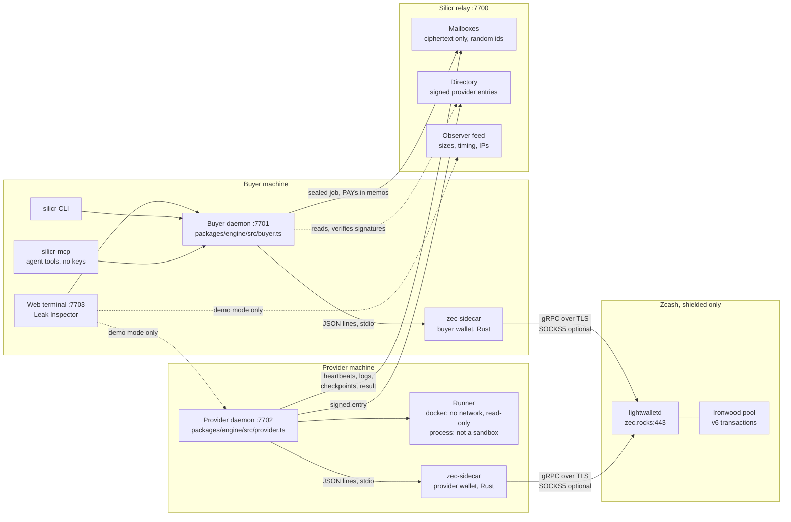
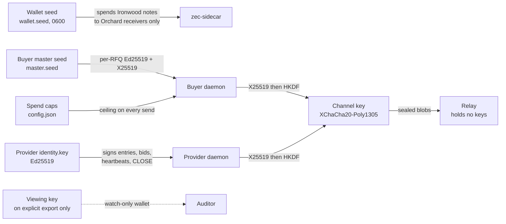
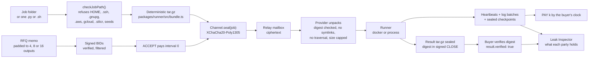
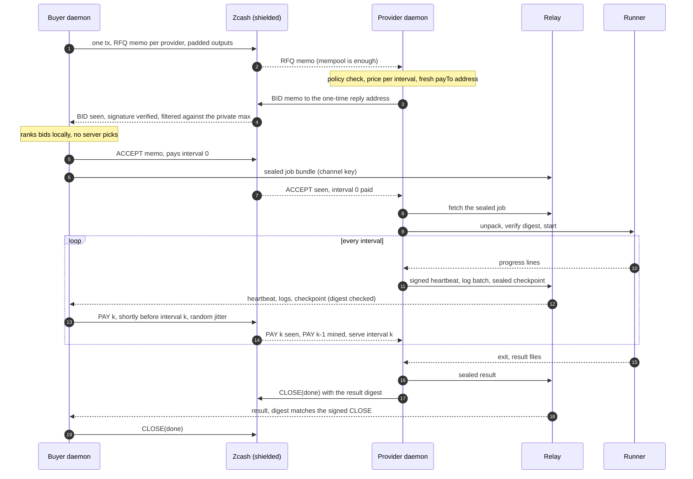
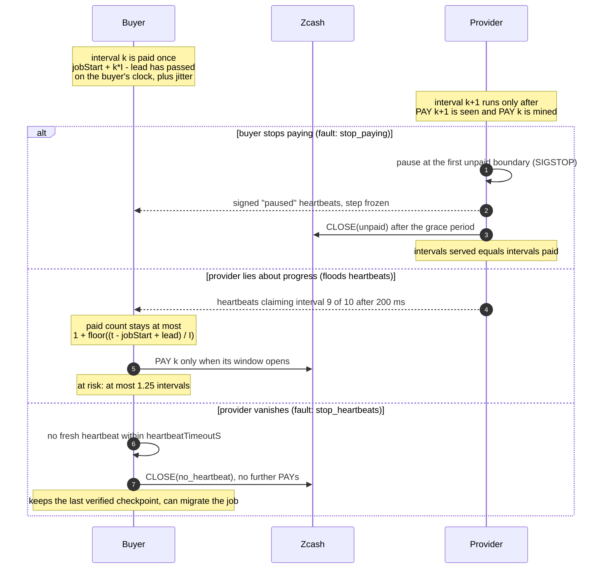
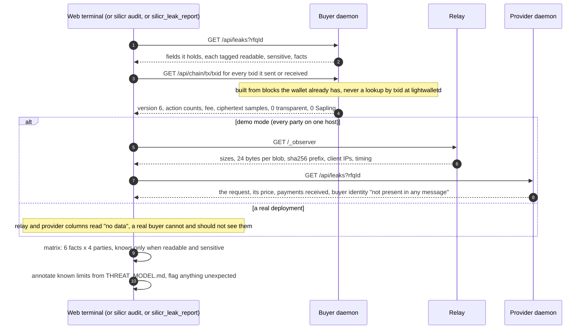
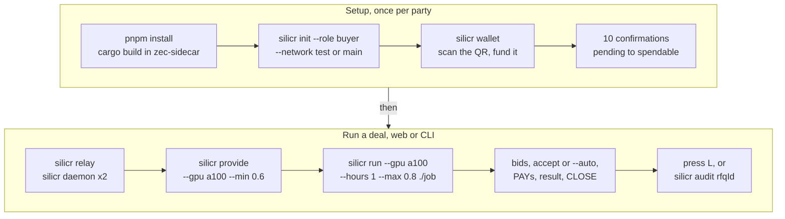

# Silicr

**Rent a GPU without telling the world: sealed requests, signed bids and pay-by-the-interval in shielded ZEC, with no server in the middle that can read the order.**

Silicr is a private compute market on Zcash. A buyer sends one shielded transaction whose encrypted memos carry a request for quotes (RFQ) to the providers it picks; providers answer with signed bids to a one-time address; the winner runs the job and is paid one interval at a time in shielded ZEC. Everything is measured by one question: **what does each party learn?** The in-app Leak Inspector answers it from real data, six facts by four parties, and a complete run reports the public chain at **0/6**, the relay at **1/6** (the buyer's IP address, a stated limit), the provider at **4/6** (the job it runs, the price it set, the amounts it received, its own identity) and the buyer at **6/6**.

Built for **ZECATHON** 2026 (a Zcash privacy hackathon by zkSNARKs), Private Markets track · Unaudited, real funds only in small amounts · App: [app.silicr.xyz](https://app.silicr.xyz) (Zcash testnet) and [mainnet.silicr.xyz](https://mainnet.silicr.xyz) (Zcash mainnet, a tiny hard-capped wallet) · Landing: [silicr.xyz](https://silicr.xyz) · Demo: `<VIDEO_URL>` · Code: [github.com/mrnetwork0001/Silicr](https://github.com/mrnetwork0001/Silicr) (private until submission, public by Oct 28, 2026)

**Judges, start here:** open [app.silicr.xyz](https://app.silicr.xyz), press **L**. That is the Leak Inspector over a real testnet deal, filled from the daemons' own data, no wallet or login needed. Then clone the repo and run `pnpm install && pnpm verify`: eleven privacy checks against a complete deal, about 15 seconds. [docs/JUDGES.md](docs/JUDGES.md) maps every claim to its check and its tests, and [THREAT_MODEL.md](THREAT_MODEL.md) lists what Silicr does not protect.

---

## Five steps, no wallet needed

| Step | What it is | Try it without a wallet |
| --- | --- | --- |
| **Seal** | The buyer's client picks providers from a public, signed, pseudonymous directory and broadcasts **one shielded transaction**. Each output carries the RFQ (GPU model, count, duration, a one-time reply address, a per-request signing key and a channel key) in a 512-byte encrypted memo only its recipient can read. Outputs are padded to **4, 8 or 16** with dummies to the buyer's own fresh addresses (`padBucket()` in `packages/engine/src/chain.ts`), so the action count does not reveal how many providers were asked. The buyer's max price stays private by default: the memo says `0` ("undisclosed"). | The **Seal a request** form at [app.silicr.xyz](https://app.silicr.xyz): the "What the chain sees" and "What the providers see" boxes update as you type. Sending needs the shared testnet wallet, which the page already has: pick a preset and send (one live request at a time, 3 per IP per hour). |
| **Bid** | Each provider's daemon decrypts the RFQ, checks its policy (`silicr provide --gpu a100 --min 0.6`) and replies with a **BID** memo signed by its directory key, naming its price per interval and a fresh payment address. The buyer verifies every signature (strict RFC 8032) and drops bids that are late, from a provider it did not ask, or above its private max. *The provider never sees the ceiling it bid under.* | Open any request at `/rfq/<id>` from the Market list: the bid table shows each bid's signature check and price. The hosted provider is `coral-walrus-55`, bidding 0.06 ZEC/h with 60-second intervals. |
| **Accept** | Accepting a bid pays interval 0 in the same shielded transaction as the **ACCEPT** memo. Both sides derive the channel key from the X25519 keys exchanged in the RFQ and the BID (`packages/protocol/src/channel.ts`): the job bundle, logs, heartbeats, checkpoints and the result travel as XChaCha20-Poly1305 ciphertext through a relay that holds no keys and cannot even group blobs by request. Matching happens in the buyer's client. **There is no order book and no matching server.** | The public demo auto-accepts the cheapest bid after one block, so a request runs unattended. On `/rfq/<id>` the **Log tail** streams the job's decrypted output and the **Payments** panel lists every shielded transaction with an explorer link. |
| **Meter** | The buyer pays interval *k* by **its own clock**, shortly before the interval starts, with random jitter (`payLeadS` in `packages/engine/src/profile.ts`). A provider that lies about progress can delay a payment but never pull one forward. The provider serves only paid intervals: at an unpaid boundary it pauses the job (SIGSTOP), and stops with `CLOSE(unpaid)` after the grace period. Worst case for the buyer: **1.25 intervals** of compute (1.2 on testnet and mainnet). At the end of every interval the provider uploads a sealed checkpoint, so a buyer whose provider vanishes keeps the work paid for and can `silicr migrate` it to another provider. | Pick the **Long training run** preset (2,000 steps, about 8 minutes): several PAY transactions land while it runs. The request's **fault menu** has "Buyer: stop paying" and "Provider: stop heartbeats": watch the provider pause at the next unpaid boundary and stop after the 180-second grace, or the buyer close with `no_heartbeat`. |
| **Inspect** | Press **L** anywhere. The **Leak Inspector** shows the same request from four viewpoints, each column built from that party's own records: the public chain from `GET /api/chain/tx/<txid>` (built from blocks the wallet already has, never a lookup that reveals interest), the relay from its `/_observer` feed, the provider and the buyer from their `GET /api/leaks`. A six-by-four matrix of "knows / hidden / no data" is computed from those fields (`apps/web/lib/facts.ts`), with a timeline playhead to scrub through the deal and **Export receipt** for a self-contained HTML record. *Nothing in it is a diagram.* | **L**, then **1** to **6** to pin a fact, **Space** to play the timeline, **Esc** to close. The same matrix comes out of `silicr audit <rfqId>` (an HTML receipt) and the MCP tool `silicr_leak_report` (JSON). |

### More to explore (no wallet needed)

| Feature | What it is | Where |
| --- | --- | --- |
| **Provider console** | The seller's side: alias, directory key, RFQ address, shielded balance, **Earned**, the job list with the buyer shown as "unknown (one-time key and reply address only)", the runner mode (the hosted one says "Jobs run unsandboxed (process mode)" in plain words), and the policy editor (GPUs, min price, interval, grace; read-only in the public demo). | [app.silicr.xyz/provider](https://app.silicr.xyz/provider) |
| **Wallet** | Fund the daemon's wallet from your own shielded wallet (Zashi, Ywallet, or any wallet that pays Orchard receivers): an Orchard-only unified address, a ZIP 321 QR code, balance with pending versus spendable and the last deposit's confirmations. Withdraw back to an Orchard receiver only; a transparent or Sapling destination is refused because a cross-pool send publishes the amount. Withdrawals are off in the public demos. | [app.silicr.xyz/wallet](https://app.silicr.xyz/wallet), `silicr wallet`, `silicr withdraw` |
| **Real ZEC demo** | The same stack on **Zcash mainnet** from a tiny shared wallet: `--public-demo --allow-mainnet --cap-per-request 0.001 --cap-total 0.005`. The header shows the red **REAL ZEC** chip and the cap ("spent 0 of 0.005 ZEC, per request ≤ 0.001"); every request's worst case (payments at the max price plus fees) must fit the cap or the daemon answers `400 spend_cap`; sending takes two clicks. The max price is capped at 0.001 ZEC/h and the provider asks 0.0005 ZEC/h. Once the wallet or the cap cannot afford the cheapest preset the daemon reports `demoExhausted: true` and the page says the demo has spent its budget. | [mainnet.silicr.xyz](https://mainnet.silicr.xyz) |
| **Agents rent compute** | `silicr-mcp`, a Model Context Protocol (MCP) server with eleven `silicr_*` tools, lets Claude Code, Claude Desktop or any MCP client rent a GPU, pay per interval in shielded ZEC and read the leak report, under a per-session spend cap (`--max-total-zec`, default 0.05 ZEC). It holds no keys and only talks to the local buyer daemon. A recorded run: 8 turns, 19 seconds, verdict `private`. | [packages/mcp/README.md](packages/mcp/README.md), [examples/agent/README.md](examples/agent/README.md), [examples/agent/TRANSCRIPT.md](examples/agent/TRANSCRIPT.md) |
| **Relay-less mode** | `--transport memo`: for small jobs the sealed job, heartbeats, log batches and the result travel inside Zcash memos as signed `BLOB` chunks (about 10.8 kB of sealed data per 40-output transaction, about 0.00019 ZEC per kB), so a deal needs nothing but the chain and the relay only serves the directory. | `silicr init --transport memo`, [ARCHITECTURE.md](ARCHITECTURE.md) (Relay-less mode), `packages/engine/src/memo-transport.ts` |
| **Audit without spending authority** | `silicr export-viewing-key` prints the wallet's Orchard-only unified full viewing key after a loud warning; `silicr watch` opens a watch-only wallet from it and prints a ledger with amounts, memos and Silicr message types. It can never sign. | [docs/ZCASH_SETUP.md](docs/ZCASH_SETUP.md), section 13 |
| **Tor** | One `--proxy socks5h://127.0.0.1:9050` setting routes the relay HTTP and the light-wallet gRPC through SOCKS5 with names resolved at the proxy and no direct fallback; the daemon refuses to start if the proxy is down. Measured against real Tor on 2026-10-21. | [docs/ZCASH_SETUP.md](docs/ZCASH_SETUP.md), section 11 |
| **Landing page** | One static page: the problem ("Your GPU bill is your roadmap"), the five steps, an illustrative Leak Inspector, the who-learns-what table copied from `THREAT_MODEL.md`, a settlement calculator computed with the engine's own rules, quick start, provider setup and FAQ. No third-party requests, no cookies. | [silicr.xyz](https://silicr.xyz) |

The web terminal (`apps/web`, Next.js) is an ops console, not a trading screen: a header with **Market** and **Provider** tabs, three connection dots (Buyer, Provider, Relay), the network chip with the current block height (red **REAL ZEC** on mainnet, with the spend cap beside it), a **Wallet** slide-over and the **Leak Inspector** toggle. It talks only to the local daemons over HTTP (`NEXT_PUBLIC_BUYER_URL`, default `http://127.0.0.1:7701`); with no daemon running it shows how to start one instead of invented data. Below 900 px the navigation folds into a drawer and the inspector becomes a full-screen sheet. There is no login: the daemon on your machine is the identity, and the hosted demos are shared wallets.

## Why shielded Zcash is essential

Without shielded transactions with memos there is no sealed order, no unlinkable reply, no private settlement and no proof.

- **No memo, no sealed order.** The RFQ, the BID, the ACCEPT, each PAY and the CLOSE are signed CBOR frames inside 512-byte ZIP 302 memos (`packages/protocol/src/memo.ts`). The message *is* the transaction, so there is nothing for an operator to read, store or front-run. The relay carries ciphertext only, and the directory holds nothing about buyers (`packages/relay/src/index.ts`).
- **No shielded value, no private payment.** Every address is a unified address reduced to its Orchard receiver (`toOrchardOnly()` in `packages/zec/src/guard.ts`), and every spend comes from the Ironwood pool (the pool Orchard receivers pay into since NU6.3, 2026-07-28). Transparent, Sapling and legacy-Orchard spends are refused in TypeScript and again in the Rust wallet, on the proposal and on the built transaction (`check_proposal` and `check_built_tx` in `zec-sidecar/src/wallet.rs`), because a turnstile withdrawal from the legacy pool publishes its amount.
- **No diversified addresses, no unlinkable replies.** Each RFQ gets a fresh reply address and a fresh Ed25519 key, and each bid a fresh payment address (`packages/protocol/src/keys.ts`, `newAddress()` in `packages/zec/src/contract.ts`), so one buyer's requests cannot be tied together, on chain or by a provider.
- **No smart contracts, and none needed.** Zcash has no escrow, so Silicr bounds loss instead: the buyer pays by its own clock, the provider serves paid intervals only, and the exposure is about one interval for either side (`packages/engine/src/buyer.ts`, `packages/engine/src/provider.ts`, `packages/engine/test/settlement.test.ts`). Plain shielded payments are the whole settlement layer.
- **No verifiable chain, no proof.** Because the chain is public, anyone can look up the three mainnet transactions below and see exactly what Silicr claims they show: version 6, zero public inputs and outputs, a fee, and nothing else.

## Architecture

Silicr has four layers:
- **The chain:** Zcash (mainnet or testnet) carries every coordination message and every payment as a shielded Ironwood transaction. Each party syncs through `zec-sidecar`, its own Rust light wallet, from a public lightwalletd.
- **The parties:** a buyer daemon and a provider daemon, each a loopback HTTP server (`silicr daemon`) with its own wallet, keys and data dir.
- **The relay:** a store-and-forward server for ciphertext blobs, plus the signed public directory and an observer feed.
- **The surfaces:** the `silicr` CLI, the web terminal, the MCP server for agents, and `pnpm verify`.

The diagrams below render on GitHub. The full design, with the memo protocol and settlement rules, is in **[ARCHITECTURE.md](ARCHITECTURE.md)**.

### System overview



**One wallet per party, one process per wallet.** The daemons never share a wallet; each spawns its own `zec-sidecar` (about 4,100 lines of Rust on librustzcash) that holds the seed, syncs compact blocks, streams the mempool and refuses any transaction that is not Ironwood-only. The TypeScript side only ever sees addresses, amounts, memos and txids. Coordination messages (RFQ, BID, ACCEPT, PAY, CLOSE) travel as memos on the chain; anything too large for a memo (the job bundle, logs, heartbeats, checkpoints, the result) is sealed with the channel key and parked at the relay under a mailbox id derived from the same secret.

**State.** Each party keeps its records in its own data dir: `buyer-state.json` or `provider-state.json`, the wallet database, results and checkpoints, all mode 0600 in a 0700 directory. The relay keeps blobs on disk under random ids with a 24-hour time to live and a `directory.json` it re-verifies on start. Nothing is shared between parties except through the chain and the relay.

### Who holds which key



| Key | Lives in | Can | Can never |
| --- | --- | --- | --- |
| Wallet seed (24-word BIP-39) | `<data dir>/wallet.seed`, read only by that party's `zec-sidecar` process | Sign shielded transactions from Ironwood notes to Orchard receivers | Pay a transparent, Sapling or legacy-Orchard address (refused in `packages/zec/src/guard.ts` and again in `zec-sidecar/src/wallet.rs`); be printed, logged, committed or sent anywhere |
| Buyer master seed | `<data dir>/master.seed` | Derive a fresh Ed25519 signing key and X25519 channel key per RFQ (`packages/protocol/src/keys.ts`) | Link two RFQs: every request signs with a different key and replies to a different address |
| Provider identity key (Ed25519) | `<data dir>/identity.key` | Sign the directory entry, BIDs, heartbeats and CLOSE | Spend ZEC: it is not a wallet key |
| Channel key | Derived in memory on both ends: `X25519(buyerEph, providerEph)`, HKDF-SHA256 with the rfqId as salt | Seal and open the job, logs, heartbeats, checkpoints and result; derive the relay mailbox ids | Reach the relay; open another request's blobs (the blob kind and rfqId are in the associated data, `packages/protocol/src/channel.ts`) |
| Spend caps | `config.json` (`--cap-per-request`, `--cap-total`), required on mainnet | Refuse any request or accept whose worst case does not fit, before anything is sent | Be bypassed by the web terminal or the MCP server: the daemon checks again before every send |
| Viewing key (ZIP 316 UFVK, Orchard only) | Nowhere, until `silicr export-viewing-key` prints it after a go-ahead | Open a watch-only wallet (`silicr watch`) that lists the whole wallet's history | Sign a transaction (refused in TypeScript and in the sidecar) |
| Relay, directory host, web terminal, MCP server | | Move ciphertext, serve signed entries, call the local daemons | Read a memo, a job, a price or an identity: they hold no keys |

A daemon binds to loopback only and refuses an `Origin` other than the web terminal's two origins and a non-loopback `Host`, so a web page from elsewhere cannot drive it (`packages/engine/src/daemon.ts`). The hosted demos add exactly one origin each with `--public-origin`.

### The job pipeline: from a folder to a verified result



The bundle is canonical (sorted entries, fixed mtime, no names), so the same folder always packs to the same bytes and the same SHA-256, which the manifest carries and the provider checks before running anything. The runner reads `SILICR_PROGRESS step=<n>` lines from the job and turns them into heartbeat progress; `examples/tiny-train/train.py` writes checkpoints to `$SILICR_CHECKPOINT_DIR` every 50 steps and resumes from them exactly, which is what makes `silicr migrate` possible.

### A deal, end to end



On the simulated chain used by the tests this takes seconds. On testnet (25-second blocks) and mainnet (75-second blocks until NU7 at height 3,543,405, about Nov 3, 2026) the bid window is about 5 to 10 minutes, but BID, ACCEPT and PAY are acted on from the mempool, so a bid can be accepted before it is mined.

### Metered settlement, and the two ways it fails safely



An earlier design paid interval *k+1* as soon as a heartbeat claimed interval *k*; the privacy audit showed a lying provider could drain a whole budget in under a second. Payment timing now comes from the buyer's clock only. The exact rules and the exposure table are in [ARCHITECTURE.md](ARCHITECTURE.md), section 4; `pnpm verify` checks 5 and 6 reproduce both faults.

### The privacy proof: how the Leak Inspector is filled



The rules are the same in the three places the matrix is computed, `apps/web/lib/facts.ts`, `packages/mcp/src/leaks.ts` and `packages/cli/src/commands/audit.ts`, and the MCP end-to-end test asserts the target cells on a real run: the chain and the relay learn none of the five deal facts, the provider never learns who the buyer is, and the buyer knows all six (`packages/mcp/test/mcp.test.ts`).

### Onboarding: from zero to a deal



On mainnet, `silicr init --network main` refuses to proceed without both spend caps, `silicr run` prints the amount and the cap and asks for a go-ahead (or `--yes`), and the terminal asks for a second click. Nothing defaults to mainnet.

### A real, verifiable run

A complete deal ran on **Zcash mainnet** on 2026-10-25, between the team's own two wallets: sealed RFQ, signed bid, accept with the interval-0 payment, the job, the sealed result and the signed close. The three transactions below were checked on [mainnet.zcashexplorer.app](https://mainnet.zcashexplorer.app) on 2026-10-25: all three are in block **3,530,216** (2026-10-25 14:27:55 UTC), **version 6**, "Shielded", **0 public inputs and 0 public outputs**, and the only number the explorer can show is the fee.

| Step | Transaction | What the explorer shows |
| --- | --- | --- |
| RFQ, sealed to one provider, padded to 4 outputs, budget undisclosed | [`244d1fe9…32be6`](https://mainnet.zcashexplorer.app/transactions/244d1fe99760611c2f3ca8250f1dafbea9561eb1ada756a307376aab68132be6) | fee 0.00025 ZEC (5 actions), 18,634 bytes |
| Provider's signed bid | [`51dedcd4…5aa4e3`](https://mainnet.zcashexplorer.app/transactions/51dedcd4f220b7f3f16c8e8ee0c66c857d2295b444f47d55c21185424f5aa4e3) | fee 0.0001 ZEC (2 actions), 9,166 bytes |
| ACCEPT plus the interval-0 payment | [`0e22a1a4…65364`](https://mainnet.zcashexplorer.app/transactions/0e22a1a447e9dd2f59dfedbe9b404e0b42cb5d2fd6ce6fa1eab6e7117f165364) | fee 0.0001 ZEC (2 actions), 9,166 bytes |

The rest is **self-reported by the buyer daemon's own record** and cannot be read from the chain, which is the point: the bid was 0.0005 ZEC/h in 600-second intervals (8,334 zatoshis per interval), one interval was bought and paid, the `examples/tiny-train` job ran, the sealed result (2,607 bytes) decrypted on the buyer and its SHA-256 matched the provider's signed CLOSE, and the fees for the whole deal came to 45,002 zatoshis (0.00045 ZEC). RFQ, bid and accept all landed in the same block because messages are acted on from the mempool. The explorer labels these "Orchard Action transfers 0" because it does not yet count Ironwood actions; `GET /api/chain/tx/<txid>` on the daemon reports them (`ironwood` in the public view, `packages/zec/src/contract.ts`).

## Safety and security model

- **The relay can never read anything.** It stores bodies as opaque bytes under 32-hex mailbox ids, never parses them, and its observer feed keeps at most the first 24 bytes (the random nonce), a size and a hash prefix (`packages/relay/src/observer.ts`). Directory writes are signature-checked, `updatedAt` is bounded to 24 hours ahead (the audit found a forged far-future entry could evict an honest one), and `directory.json` is re-checked on start.
- **The web terminal, the MCP server and the CLI hold no keys.** They are HTTP clients of a daemon on loopback. The MCP server adds its own per-session cap and refuses a request whose worst case (`hours × max price`) does not fit before the daemon is even asked.
- **Hard limits, where enforced:** spend caps per request and in total (`checkSpendCap()` in `packages/engine/src/base.ts`, required on mainnet); the public demo's `durationS ≤ 900`, `count ≤ 1`, one live request, 3 per IP per hour, presets only (`packages/engine/src/daemon.ts`); on the mainnet demo, max price 0.001 ZEC/h and the worst case checked against the cap before any transaction (`400 spend_cap`, `402 insufficient_funds`); relay bodies ≤ 16 MiB, 10,000 messages per mailbox, 8 GiB in all; bundles ≤ 512 MiB; checkpoints ≤ 64 MiB packed.
- **Price and input protection:** the buyer's max price stays private unless `--disclose-max`; bids above it, late, forged or from unasked providers are dropped and counted (`rejectedBids`); every memo is a signed frame with strict verification (canonical encodings, small-order keys rejected) and 5,000 fuzz cases plus every single-byte flip of every message fail to forge one (`packages/protocol/test/memo-fuzz.test.ts`); a replayed PAY is rejected as already paid; an ACCEPT that underpays interval 0 is refused; `checkJobPath()` refuses to ship `$HOME`, `~/.ssh`, `~/.gnupg`, `~/.aws`, gcloud config, any `.silicr` dir or a seed file (`packages/engine/src/jobpath.ts`).
- **Kill switches:** `silicr stop <rfqId>` sends `CLOSE(buyer_stop)` and payments end; a provider stops its own job with `CLOSE(provider_stop)`; stop paying and the provider pauses, then stops; stop heartbeats and the buyer closes. `Ctrl-C` on a daemon kills its job's process group or removes its container on exit.
- **Only an explicit `--network main` touches real money.** Tests, `pnpm verify` and `silicr demo` never do; a mainnet daemon refuses to start without caps; `--public-demo` is refused on mainnet without `--allow-mainnet`; the sidecar refuses a server whose chain is not the one requested and a wallet directory created on the other network.
- **The sandbox is Docker, and process mode says it is not one.** Docker mode runs `--network none --cap-drop ALL --security-opt no-new-privileges --read-only --pids-limit 1024` with CPU and memory limits, the bundle mounted read-only and a random container name (`dockerRunArgs()` in `packages/runner/src/docker.ts`). Process mode is a child process with the provider's user and is labelled "NOT a sandbox" in the status, the terminal and `pnpm verify`.
- **Secrets never leave the owner's data dir.** Seeds, identity keys and state files are written atomically with mode 0600 in 0700 directories; signers keep the secret in a closure; guard errors never echo the refused input; nothing logs a seed, a key, memo plaintext or job contents. `pnpm verify` check 8 searches everything printed, the node logs, the observer feed and every relay file for 20 secrets as hex, base64 and raw bytes.
- **Test coverage, measured on 2026-10-25:** `pnpm test` ran 912 tests across 8 packages, **891 passed, 21 skipped, 0 failed** (the skips are the 14 live-network tests behind `SILICR_TESTNET_LIVE` / `SILICR_MAINNET_LIVE` and 7 Docker probes that need a Docker daemon). `cargo test --release` in `zec-sidecar`: **22 passed, 0 failed**. `pnpm verify`: **PASS: 11/11 checks passed in 12.8 s**.

## What's real and what's simulated

| Real | Simulated, not built, or not what the label says |
| --- | --- |
| **The market, the payments, the encryption and the privacy.** Every deal on testnet or mainnet is real shielded Zcash transactions with real memos, real Ed25519 signatures, a real X25519 and XChaCha20-Poly1305 channel, and real ZEC moving from buyer to provider. | **The demo providers advertise an A100 but run jobs on the CPU.** The hosted testnet provider's directory entry says `1× a100 (80 GB) + 8× cpu` and `silicr demo` advertises `1× a100`; the VPS has no GPU, and `examples/tiny-train` is a pure-Python job that runs anywhere. The mainnet demo provider advertises `1× cpu`. A `GpuSpec` in the directory is a claim the provider makes, not something Silicr checks (THREAT_MODEL.md, limit 3). |
| **The three mainnet transactions above**, and every testnet deal on [app.silicr.xyz](https://app.silicr.xyz) (4 requests between 2026-10-24 and 2026-10-25: 3 completed with a payment each, 1 expired unaccepted). | **GPU pass-through is untested on real GPU hardware.** `packages/runner/src/docker.ts` adds `--gpus N` only when the request asks for a non-CPU model and the Docker host reports an NVIDIA runtime (`info.nvidia`), otherwise it runs on CPU and says so. No one has run it on a machine with an NVIDIA GPU. |
| **The job:** `examples/tiny-train` trains a character-level bigram model with checkpoints, resumes exactly, and returns `model.json`, `metrics.json` and `sample.txt`. | **The hosted providers run jobs as a process inside their container, not in the Docker sandbox.** No Docker socket is mounted on the VPS; the container (read-only root, `cap_drop ALL`, `no-new-privileges`, tmpfs `/tmp`, 1 CPU, 1 GB, pid limit 256) is the sandbox, and it still has outbound network access because the wallet needs lightwalletd. `--public-demo` presets are what keep strangers' jobs harmless. Their status reads `runner.sandboxed: false`. |
| **The Leak Inspector's data**: decoded memos, relay observations and public transaction views as each party recorded them. | **The hosted demos use one shared wallet per party**, so every visitor's request comes from the same buyer wallet and goes to the same provider. A real deployment is one wallet per party, on their own machines. |
| **The Rust light wallet** (`zec-sidecar`), syncing from a public lightwalletd, proving real Ironwood transactions. | **The simulated chain exists only in the test suite** and in `pnpm verify` (`createMemoryNetwork()` in `packages/zec/src/memory.ts`: Orchard-only recipients, ZIP 317 fees, padding, mempool then blocks, but no zero-knowledge proofs and nothing leaves the process). It is never offered to a user; `pnpm verify` says "test harness: simulated chain" on its first line. |
| **The relay, directory, observer feed, signatures, bundle packing and the runner's isolation checks** are the same code in the tests and in production. | **TEE execution and provider bonds are not built.** Hiding the workload from the winning provider would need a trusted execution environment with attestation; the FROST 2-of-3 bond with slashing and the Noir job-count proof are stretch goals described in [ARCHITECTURE.md](ARCHITECTURE.md), sections 5 and 6, and nowhere in the code. The landing page labels bonds "Roadmap, not built" and every directory entry in the terminal shows "no bond". |
| **The Tor path** was measured against a real Tor daemon and an onion-service relay on 2026-10-21. | **The Leak Inspector on the hosted demos** shows "no data" for the relay column until the observer feed answers, and older requests can show fewer observations than a fresh one: daemon observations live in memory, and the hosted daemons restart on deploy. The 0/6, 1/6, 4/6, 6/6 figures come from a complete run (`examples/agent/README.md`, `packages/mcp/test/mcp.test.ts`), not from an old request after a restart. |

### Known limits, from THREAT_MODEL.md, unsoftened

1. **The workload is visible to the winning provider.** Hiding it would need TEE execution with attestation, which is future work. Buyers with secret weights should treat providers as able to see their code and data.
2. **Network metadata.** Without a proxy, the relay sees both parties' IP addresses and the light-wallet server sees each wallet's IP and broadcasts. With `--proxy socks5h://127.0.0.1:9050` (Tor) every outbound connection, DNS included, goes through the proxy and nothing falls back to a direct connection, so they see Tor's address instead. What a proxy does not hide: timing (limit 4), a wallet's birthday height, the fact that a transaction was broadcast at that moment, and Docker image pulls, which the provider's Docker daemon makes from its own IP. A plain `http://` relay is readable by the Tor exit (ciphertext and sizes only); use https or a `.onion` relay.
3. **No proof of correct computation.** Heartbeats show the job is progressing, not that it ran on the claimed GPU or produced honest outputs. Bonds and reputation discourage cheating but don't prevent it.
4. **Timing correlation and the payment train.** The light-wallet server sees the buyer's IP broadcast one padded RFQ, then a run of uniform 2-action payments. From that it can link one job's transactions and infer roughly how long the job ran. Random jitter on payment times blurs the cadence, but not the count. Whoever runs the relay can also line up blob timing with chain timing. Mitigations not yet built: batched payments, randomised upload delays, Tor, and running your own light-wallet server.
5. **Losing bidders see demand.** RFQ details reach every provider asked. Buyers control this by choosing how many to ask.
6. **The arbiter is trusted** in the FROST bond flow (stretch only).
7. **Process-mode runner is not a sandbox.** The Docker runner isolates jobs: no network, read-only filesystem, all capabilities dropped. The process-mode fallback, used when Docker is unavailable, does not, and the provider's status says so.

## Tech stack

TypeScript 7.0 (erasable syntax only, ESM, no build step: packages export `src/index.ts` and run under tsx 4), Node 22 or newer, pnpm 9.15 workspaces, Vitest 5; crypto and encoding from `@noble/ciphers`, `@noble/curves`, `@noble/hashes` and `@scure/base` 2.4 only; `commander` 15 (CLI), `tar` 7 (bundles), `qrcode` 1.5 (ZIP 321 QR), `@modelcontextprotocol/sdk` 1.32 and `zod` 4 (MCP); Next.js 16.3 with React 19.3 and Tailwind CSS 4.3 for the terminal and the static landing page; Rust 1.98 (`rust-version` 1.89) with librustzcash (`zcash_client_backend` 0.25, `zcash_client_sqlite` 0.23, `zcash_primitives` 0.31, `orchard` 0.16, bundled Sapling prover) and `tonic` 0.14 for the light wallet; public lightwalletd at `zec.rocks:443` (mainnet) and `testnet.zec.rocks:443` (testnet); Docker (NVIDIA Container Toolkit when present) for jobs; Docker Compose, nginx and certbot on one VPS for the hosted demos; the Model Context Protocol for agents.

## Run it locally

Prerequisites: Node ≥ 22, pnpm 9, `python3` on `PATH` (the example job), and for a real chain Rust ≥ 1.89 (`cargo build --release` in `zec-sidecar/`, about 1.5 minutes cold, a 73 MB binary). Docker is optional: without it the provider runs jobs in process mode and says so.

```bash
pnpm install
pnpm verify                         # test harness: a complete deal on the simulated chain, 11 privacy checks, ~15 s
pnpm test                           # every package's Vitest suite
pnpm typecheck
cd zec-sidecar && cargo build --release && cargo test --release && cd ..
```

A deal on **Zcash testnet** (the local ports are relay 7700, buyer 7701, provider 7702, web 7703, landing 7704):

```bash
pnpm silicr init --role buyer --network test --data .silicr/wallets/test-buyer       # prints a utest1… address: fund it from a faucet (docs/ZCASH_SETUP.md, section 3)
pnpm silicr init --role provider --network test --data .silicr/wallets/test-provider
pnpm silicr demo --keep             # relay + both daemons on testnet, runs the tiny-train deal, stays up for the terminal
pnpm --filter @silicr/web dev       # http://localhost:7703, press L
pnpm --filter @silicr/landing dev   # http://127.0.0.1:7704
```

Or run the parties by hand: `pnpm silicr relay --observer`, `pnpm silicr daemon --data .silicr/wallets/test-provider`, `pnpm silicr daemon --data .silicr/wallets/test-buyer`, then `pnpm silicr provide --gpu a100 --min 0.6` and `pnpm silicr run --gpu a100 --hours 0.15 --max 0.08 --auto examples/tiny-train -- python3 train.py`. `pnpm silicr --help` lists every command: `demo`, `init`, `daemon`, `relay`, `run`, `provide`, `status`, `audit`, `wallet`, `withdraw`, `rfqs`, `jobs`, `bids`, `accept`, `stop`, `migrate`, `result`, `mcp`, `fault`, `export-viewing-key`, `watch`.

**Mainnet** is `--network main` on `init` and `daemon`, with `--cap-per-request` and `--cap-total` required; read [docs/MAINNET.md](docs/MAINNET.md) first. A short demo costs under 0.002 ZEC in fees.

| Variable | What it does |
| --- | --- |
| `NEXT_PUBLIC_BUYER_URL`, `NEXT_PUBLIC_PROVIDER_URL`, `NEXT_PUBLIC_RELAY_URL` | Where the web terminal finds the daemons and the relay. Defaults `http://127.0.0.1:7701`, `:7702`, `:7700`. A path prefix is allowed behind a reverse proxy (the hosted demos use `/api/buyer`, `/api/provider`, `/api/relay`). Inlined at build time. |
| `NEXT_PUBLIC_EXPLORER_TX_URL_MAIN`, `NEXT_PUBLIC_EXPLORER_TX_URL_TEST` | Block-explorer link templates with `{txid}`. Defaults `https://mainnet.zcashexplorer.app/transactions/{txid}` and `https://zexplorer.app/testnet/tx/{txid}`. An explorer is a third party: clicking tells it which txid you care about. |
| `NEXT_PUBLIC_LANDING_URL` | Where the terminal's logo links. Default `http://127.0.0.1:7704`; empty disables the link. |
| `NEXT_PUBLIC_APP_URL`, `NEXT_PUBLIC_MAINNET_URL`, `NEXT_PUBLIC_REPO_URL`, `NEXT_PUBLIC_REPO_BRANCH`, `NEXT_PUBLIC_DEMO_VIDEO_URL`, `NEXT_PUBLIC_SITE_URL` | Landing page links: the Launch app target (default the local terminal), the real-ZEC demo link, the source and threat-model links, the "Watch the demo" link and the Open Graph image origin. Unset links are hidden, never shown as placeholders. |
| `SILICR_PROXY` | SOCKS5 proxy (`socks5h://host:port`) for every outbound connection of a daemon or the sidecar; `--proxy` on the command line and the `proxy` key in `config.json` are the other two ways to set it. Unset means direct connections, and `silicr status` says so in yellow. |
| `SILICR_ZEC_SIDECAR` | Path to the `zec-sidecar` binary. Unset: `zec-sidecar/target/release/zec-sidecar`, else a `SidecarMissingError` that prints the build command. |
| `SILICR_BUYER_URL`, `SILICR_PROVIDER_URL`, `SILICR_RELAY_URL`, `SILICR_MCP_MAX_TOTAL_ZEC`, `SILICR_MCP_OUT_DIR` | The MCP server's daemon URLs, per-session cap (default 0.05 ZEC) and result directory (default `.silicr/mcp-results`). |
| `SILICR_TESTNET_LIVE=1`, `SILICR_MAINNET_LIVE=1` | Opt in to the live-network tests in `packages/zec/test/` (throwaway wallets; the mainnet one never spends). Unset, those tests skip. |
| `SILICR_STEPS`, `SILICR_STEP_DELAY_MS`, `SILICR_CHECKPOINT_EVERY` | Knobs of the example job (`examples/tiny-train/README.md`). Defaults 600, 250 and 50. |

Per-party settings (network, relay URL, port, light-wallet server, spend caps, runner, proxy, transport) live in each data dir's `config.json`, written by `silicr init`; see `packages/cli/src/config.ts`. The two app `.env.example` files are [`apps/web/.env.example`](apps/web/.env.example) and [`apps/landing/.env.example`](apps/landing/.env.example).

**Test status, measured on 2026-10-25 in this checkout:**

| Suite | Result |
| --- | --- |
| `pnpm test` (8 packages) | 912 tests: **891 passed, 21 skipped, 0 failed**. By package: protocol `325 passed`, zec `205 passed, 14 skipped` (live-network tests), engine `128 passed`, web `64 passed`, runner `52 passed, 7 skipped` (Docker probes), relay `46 passed`, cli `50 passed`, mcp `23 passed`. |
| `cargo test --release` in `zec-sidecar` | `test result: ok. 22 passed; 0 failed; 0 ignored` |
| `pnpm verify` | `PASS: 11/11 checks passed in 12.8 s` |

## Deploying

1. **One VPS, two compose projects.** `deploy/deploy.sh` rsyncs the repo (never `node_modules`, `.git`, `.silicr` or any wallet), builds three images with the classic Docker builder (`silicr-sidecar`, `silicr-landing`, `silicr-node`), copies the static landing export to `/var/www/silicr/landing`, and starts the `silicr` project (testnet: relay, provider, buyer, web on `127.0.0.1:8700` to `8703`) from [deploy/compose.yml](deploy/compose.yml). `deploy/deploy.sh --main` does the same for the `silicr-main` project (mainnet demo, ports 8710 to 8713) from [deploy/compose.main.yml](deploy/compose.main.yml). Every container is read-only with `cap_drop: ALL`, `no-new-privileges`, a tmpfs `/tmp`, CPU, memory and pid limits, a health check and capped logs.
2. **Wallets.** On the first run of each mode (or with `--wallets`) the script copies exactly two wallet directories with `scp`: `test-buyer` and `test-provider` for testnet, `demo-main-buyer` and `demo-main-provider` for mainnet, refusing anything else and any wallet whose `config.json` is on the other network. The team's own mainnet wallets (`main-buyer`, `main-provider`, the ones behind the transactions above) are never copied anywhere. The daemons bind to loopback inside their containers by design, so each runs `deploy/fwd.mjs`, a byte-for-byte TCP forwarder, to reach the published port.
3. **nginx and certificates.** [deploy/nginx-silicr.conf](deploy/nginx-silicr.conf) terminates TLS for `silicr.xyz`, `www.silicr.xyz`, `app.silicr.xyz` and `mainnet.silicr.xyz` on one certificate, serves the landing page as static files, proxies each terminal, and mounts the daemons under `/api/buyer/`, `/api/provider/` and `/api/relay/` (`/api/buyer/api/events` is the Server-Sent Events stream). The script issues missing certificates with `certbot --webroot`, runs `nginx -t` before every install and only reloads, never restarts. The old names `silicr.38-49-213-208.sslip.io` and `app.silicr.38-49-213-208.sslip.io` still work as aliases.
4. **Public demo gates.** The daemons start with `--public-demo --trust-proxy --public-origin https://app.silicr.xyz`: presets only, 15 minutes at most, one GPU, one live request, 3 per IP per hour (the IP comes from the last `X-Forwarded-For` entry, the one nginx appended), unaccepted requests expire 4 blocks after the bid window, `stop`, `accept` and `fault` work only from the IP that made the request, and withdraw, `PUT /api/policy`, migrate and provider stop answer `403 demo_disabled`. The provider bids 60-second intervals so a long run shows several payments. The script starts a daemon only if the image's `silicr daemon --help` lists those flags.
5. **Mainnet-only gates.** `--allow-mainnet` with `--cap-per-request 0.001 --cap-total 0.005`: without the caps the daemon refuses to start; the engine treats the cap as a hard ceiling on each request's worst case; the max price is capped at 0.001 ZEC/h; the provider asks 0.0005 ZEC/h and bids only while it holds at least 0.0003 ZEC for a BID and a CLOSE fee (`bidding.reason` in its status says why otherwise). With 0.005 ZEC in the buyer and about 0.001 ZEC in the provider the demo affords roughly two long runs or six quick ones, then reports itself exhausted.
6. **Live:** [silicr.xyz](https://silicr.xyz), [app.silicr.xyz](https://app.silicr.xyz) and [mainnet.silicr.xyz](https://mainnet.silicr.xyz). Checked on 2026-10-25 at 23:00 UTC: the testnet buyer held 1.786 TAZ with 4 requests on record. The mainnet demo wallets were funded that evening (buyer 0.005 ZEC, provider 0.001 ZEC) and the **first live run through the hosted mainnet demo** closed at 22:54 UTC with the result verified: RFQ [`61eca70f…`](https://mainnet.zcashexplorer.app/transactions/61eca70f4a80d40f72d5ee2479667418b63d708d0ce240a65a3ca3a87c421773), bid [`27d48b99…`](https://mainnet.zcashexplorer.app/transactions/27d48b99287f6f32474aeac72d73ef2c937625e9890d0d0baabf7c001a491be6) (block 3,530,571), accept and interval payment [`500ccca0…`](https://mainnet.zcashexplorer.app/transactions/500ccca0826e3ce054a80afab4130d187a409a933b4294272b6434e6ad422b8f) (block 3,530,573); 0.00070836 ZEC of the 0.005 ZEC budget spent, `demoExhausted: false`. When the budget runs out the page says so until the wallets are topped up (their `u1…` addresses are on [mainnet.silicr.xyz/wallet](https://mainnet.silicr.xyz/wallet)).
7. **First live run.** The mainnet deal of 2026-10-25 (block 3,530,216, the table above) ran between the team's own wallets on this code, not on the hosted demo.

## Repository map

```
packages/protocol/     memo protocol v1 (RFQ, BID, ACCEPT, PAY, CLOSE as signed CBOR frames), Ed25519 and X25519 keys,
                       the XChaCha20-Poly1305 channel, signed directory entries, heartbeats, memo chunking; pure, no I/O
packages/zec/          ZecBackend contract, ZIP 316 unified-address codec and the Orchard-only guard (guard.ts), the simulated
                       memory chain (tests only), the sidecar backend (src/testnet/), scripts/testnet-roundtrip.ts
packages/relay/        ciphertext-only mailboxes, the signed public directory, the observer feed, the client, SOCKS5 proxying
packages/runner/       deterministic job bundles, safe unpacking, docker.ts (sandbox args, --gpus) and process.ts (not a sandbox)
packages/engine/       buyer.ts and provider.ts (the two nodes), daemon.ts (the loopback HTTP API and public-demo rules),
                       settlement timing (profile.ts), presets.ts, jobpath.ts (what never gets shipped), leaks.ts, memo-transport.ts
packages/cli/          the silicr command: src/program.ts lists every command, src/commands/ implements them
packages/api/          the daemon <-> web JSON contract (types only)
packages/mcp/          silicr-mcp: eleven MCP tools over the buyer daemon with a per-session cap; src/leaks.ts builds the report
apps/web/              the terminal (Next.js): / Market, /provider, /wallet, /rfq/[id]; components/inspector/ is the Leak Inspector,
                       lib/facts.ts the matrix, lib/receipt.ts the HTML receipt
apps/landing/          the static landing page (Next.js export); lib/settlement.ts computes the numbers it shows
zec-sidecar/           the Rust light wallet: wallet.rs (Ironwood-only spend policy, both guards), inspect.rs (public tx views
                       from local data), mempool.rs, socks.rs, keys.rs (viewing keys); testdata/ holds a real v6 transaction
examples/tiny-train/   the demo job: a bigram model with checkpoints, SILICR_PROGRESS lines, exact resume
examples/agent/        the MCP walkthrough and a recorded transcript
scripts/verify-privacy.ts   pnpm verify: the judges' kit, 11 checks against a complete deal
deploy/                Dockerfiles, compose.yml (testnet), compose.main.yml (mainnet demo), deploy.sh, nginx config, fwd.mjs
docs/                  JUDGES.md (claims to checks), MAINNET.md (the mainnet checklist), ZCASH_SETUP.md (wallet, Tor, viewing keys)
ARCHITECTURE.md        components, the memo protocol, settlement, relay-less mode, the stretch goals
THREAT_MODEL.md        what every party learns, the mitigations shipped, and the known limits
PRODUCT_REQUIREMENTS.md   the target, scope and the build plan
```

Interfaces other packages build against are each package's `src/contract.ts` (protocol, zec) or the documented types in `src/index.ts` (relay, runner, api). The daemon's routes are listed in `packages/engine/src/daemon.ts`: `GET /api/status`, `/api/providers`, `/api/leaks`, `/api/chain/tx/:txid`, `/api/events`, `/api/wallet`, `POST /api/wallet/withdraw`; buyer `GET|POST /api/rfqs`, `GET /api/rfqs/:id`, `POST /api/rfqs/:id/{accept,stop,migrate,fault}`, `GET /api/rfqs/:id/result`; provider `GET /api/jobs`, `GET /api/jobs/:id`, `POST /api/jobs/:id/{stop,fault}`, `GET|PUT /api/policy`.

## Privacy policy and content

Silicr collects nothing. The landing page and the terminal make no third-party requests, set no cookies and load no analytics; the only external links are the block explorers, which are labelled as third parties. The hosted daemons keep each visitor's IP in memory for the rate limit and the request-owner check, and nothing else about visitors. Jobs sent to the public demos are server-side presets; a visitor's own files never reach the VPS. Wallet seeds live under `.silicr/` (gitignored) and are never committed, logged or printed.

## Pre-existing work and credits

- **Zcash libraries.** `zec-sidecar` is built on the Zcash Rust crates (`zcash_client_backend`, `zcash_client_sqlite`, `zcash_primitives`, `zcash_proofs` with the bundled Sapling prover, `orchard`, `zip321`, `zcash_address`), used as published on crates.io; `zcash-devtool` served as the wiring reference during the Week 0 spike and seeded `Cargo.lock`. No wallet code is vendored.
- **Public infrastructure.** The `zec.rocks` lightwalletd servers (mainnet and testnet), the testnet faucets listed in `docs/ZCASH_SETUP.md`, and the block explorers linked above. Each is a third party and appears as one in the threat model.
- **Test vectors.** `packages/zec/test/vectors/` holds the F4Jumble and unified-address vectors from the Zcash test-vector repository (see its README there).
- **Open-source npm packages** are listed in each `package.json`: `@noble/*` and `@scure/base` for cryptography and encoding, `commander`, `tar`, `qrcode`, `@modelcontextprotocol/sdk`, `zod`, Next.js, React and Tailwind. The two Next.js apps started from `create-next-app` (config files and base layout).
- **No prior Silicr code.** Everything else was written for ZECATHON 2026 between Oct 1 and Oct 28.

## License

Dual-licensed under [MIT](LICENSE-MIT) or [Apache-2.0](LICENSE-APACHE), at your option, like the Zcash Rust libraries Silicr builds on. `zec-sidecar/Cargo.toml` carries `MIT OR Apache-2.0`.

---

Silicr is an independent ZECATHON 2026 entry and is not affiliated with the Electric Coin Company, the Zcash Foundation or zkSNARKs. It is unaudited software that moves real money on mainnet: keep balances small, read the threat model, and treat the hosted demos as what they are, shared wallets running a toy job on a CPU.
